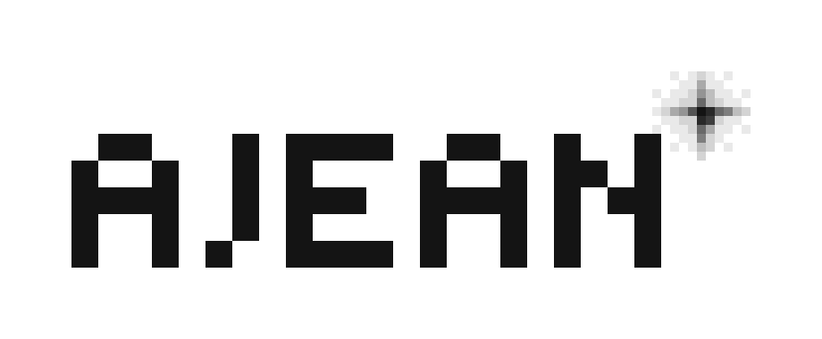
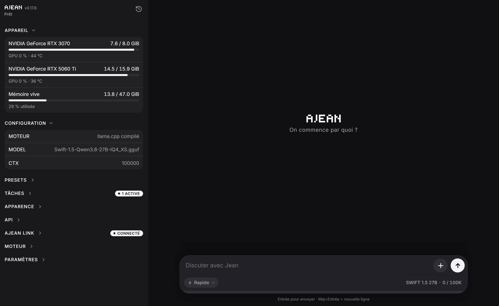

<p align="center">
  <picture>
    <source media="(prefers-color-scheme: dark)" srcset="docs/logo-dark.png">
    
  </picture>
</p>

[English](README.md) · **Français**



**Votre propre IA, chez vous.** AJEAN est un programme unique qui transforme un ordinateur équipé d'une carte graphique (ou d'un simple processeur) en assistant IA complet : une interface de discussion, une mémoire, des outils, l'accès au web, des tâches planifiées et l'accès depuis votre téléphone, sans que rien ne quitte votre machine.

AJEAN s'occupe de tout ce qui entoure le modèle. Le modèle tourne sur le moteur de votre choix (llama.cpp, ExLlama, vLLM, etc.) ou sur une API distante compatible OpenAI. AJEAN le démarre, l'arrête et le surveille.

- **Un seul fichier, aucune dépendance.** Ni Docker, ni Python, ni environnement à installer. Linux, Windows et macOS.
- **Un assistant, pas seulement un modèle.** Il se souvient, range le travail en projets, exécute des commandes, lit le web, pilote un navigateur et travaille seul selon un planning.
- **Vos données restent chez vous.** Tout tourne sur votre machine. La mémoire et les conversations peuvent être chiffrées sur le disque, et l'accès à distance est chiffré de bout en bout.
- **Utilisable de partout.** Les mêmes conversations sur l'ordinateur et le téléphone, en direct.
- **Se branche sur vos outils.** Un point d'accès compatible OpenAI pour n'importe quelle application tierce.

---

## Sommaire

- [Installation](#installation)
- [Utiliser AJEAN](#utiliser-ajean)
- [Ce que l'IA sait faire](#ce-que-lia-sait-faire)
- [Modèles](#modèles)
- [Accès de partout](#accès-de-partout)
- [Vos données](#vos-données)
- [Référence](#référence)
- [Compiler depuis les sources](#compiler-depuis-les-sources)

---

## Installation

Téléchargez le fichier de votre système depuis la [dernière version](https://github.com/nathaninline/ajean/releases/latest) :

| Système | Fichier |
|---|---|
| Windows | `ajean-windows.exe` (`ajean-windows-arm.exe` pour ARM) |
| macOS | `ajean-macos-arm.zip` (Apple Silicon), `ajean-macos.zip` (Intel) |
| Linux | `ajean-linux` (`ajean-linux-arm` pour ARM) |

### Windows

Double-cliquez sur `ajean-windows.exe`. AJEAN s'installe, crée ses raccourcis et s'ouvre dans sa propre fenêtre, avec une icône dans la zone de notification (*Ouvrir AJEAN* / *Quitter*). Lancer plus tard un fichier plus récent met à jour la copie installée.

Ajoutez ensuite un modèle dans la section **Presets** du menu (voir [Modèles](#modèles)). Le moteur s'installe à part : voir [docs/moteurs.md](docs/moteurs.md). La création du service Windows demande une fois les droits administrateur.

### macOS

Décompressez, glissez **AJEAN.app** dans *Applications*, puis faites **clic droit, Ouvrir** la première fois (l'application n'a qu'une signature ad hoc). AJEAN s'ouvre dans sa propre fenêtre et vit dans la barre de menus. Ajoutez ensuite un modèle comme sous Windows.

Pour la ligne de commande, prenez plutôt le binaire nu `ajean-macos-arm` / `ajean-macos`.

### Linux (serveur)

```bash
curl -L -o ajean https://github.com/nathaninline/ajean/releases/latest/download/ajean-linux
chmod +x ajean && sudo mv ajean /usr/local/bin/ajean

sudo ajean install              # interface, assistant des services, gardien RAM, dossiers
sudo ajean ui start             # interface sur http://<hôte>:8090
```

Ajoutez ensuite un modèle depuis l'interface (section **Presets**, bouton +) ou en ligne de commande :

```bash
ajean service add modele.json   # déclarer un modèle (voir docs/moteurs.md)
ajean service use <id>          # le démarrer et brancher le chat dessus
```

`ajean install` installe trois choses : le service `ajean-ui` (interface, accès à distance, point d'accès OpenAI), un assistant root (`/usr/local/sbin/ajean-svc`, avec une règle sudoers) qui n'agit que sur les services gérés par AJEAN, et le gardien RAM `ajean-guard`. Les modèles sont des unités systemd système : ils tournent sans session ouverte, et redémarrer l'interface ne recharge jamais le modèle.

### Mettre à jour

```bash
ajean update
```

Ou le bouton de mise à jour dans l'interface. Chaque version est vérifiée avec ses sommes de contrôle publiées avant d'être installée.

---

## Utiliser AJEAN

### Quatre modes de discussion

Choisissez le mode avec le bouton à gauche de la zone de saisie.

| Mode | Pour | Ce dont l'IA dispose |
|---|---|---|
| **Rapide** | questions rapides, petites tâches | terminal et fichiers, sans mémoire |
| **Projet** | un vrai travail qui s'étale sur plusieurs conversations | mémoire, trackers, web, navigateur, MCP, tâches |
| **Jean** | un assistant personnel qui vous connaît | sa propre mémoire, des rappels, une conversation unique et continue |
| **Modèle de base** | parler au modèle brut | rien : ni outils, ni prompt système |

Une conversation garde le mode dans lequel elle a commencé. Les outils n'existent que si le **mode agent** est activé (`ajean agent on`, ou l'interrupteur de l'interface) ; sans lui, tous les modes se comportent comme Modèle de base.

### Projets

Un projet est un espace de travail avec **sa propre mémoire et ses propres conversations**, cloisonnées des autres : un pour l'automatisation de votre boîte mail, un pour un logiciel, un pour vos notes. On change de projet depuis la bulle de la zone de saisie.

Chaque projet a :

- **Une mémoire** : des pages Markdown que l'IA lit et écrit d'une conversation à l'autre, avec un index tenu à jour automatiquement.
- **Des trackers** : des données datées qui s'accumulent (un nombre d'abonnés relevé chaque semaine, un poids, un chiffre d'affaires). L'IA les parcourt niveau par niveau au lieu de tout charger.
- **Une description**, fournie à l'IA au début de chaque conversation (contexte, contraintes, ton).
- **Des options** dans son menu *⋯* : nom et description, sa mémoire, ses trackers.

### Jean, assistant personnel

Jean est un assistant qui se souvient de **vous** au fil du temps, dans une seule conversation qui ne se termine jamais. Ouvrez-le depuis le menu des modes : il s'affiche en plein écran avec son avatar.

- **Sa propre mémoire** : un profil court (prénom, proches, préférences, habitudes), des *fiches* (procédures, recettes, guides gardés en entier) et un journal où chaque échange est consigné et peut être recherché. La fenêtre *Mémoire de Jean* permet de tout consulter, corriger ou supprimer.
- **Rappels et tâches** : demandez à Jean de vous rappeler quelque chose, et le rappel arrive comme un message de sa part, avec une notification.
- **Un espace de travail séparé** : Jean ne peut pas modifier les scripts, fichiers ni la mémoire de vos projets. Il peut les lire, pour voir comment une chose a été faite, et refaire ce dont il a besoin dans son propre espace.
- **Un nouveau départ après une pause** : après 3 heures sans message, le contexte du modèle repart à vide. Le fil affiché et le journal restent.

### Historique

L'icône horloge en haut du menu latéral affiche l'historique. Il suit ce que vous faites : les conversations du projet actif en mode Projet, les conversations rapides en mode Rapide, celles du modèle de base en mode Modèle de base. La recherche couvre toutes les conversations. Une conversation peut être renommée, mise en favori, déplacée vers un autre projet et exportée en Markdown ou en JSON.

Les conversations vivent sur le serveur : elles sont **les mêmes sur tous les appareils**, en direct. Posez une question sur l'ordinateur, lisez la réponse sur le téléphone. Fermer le navigateur n'arrête jamais une réponse.

### Dans le terminal

```bash
ajean chat
```

Une discussion légère dans le terminal, indépendante de l'interface web, avec trois outils (`bash`, `write`, `edit`) qui agissent **dans le dossier où vous la lancez**. Pratique pour travailler sur un dossier de projet.

---

## Ce que l'IA sait faire

Ces outils ne sont fournis au modèle que lorsque le mode agent est activé.

**Terminal et fichiers.** L'IA exécute des commandes (bash, ou `cmd.exe` sous Windows) et écrit ou modifie des fichiers. Elle travaille dans un **dossier de travail** jetable ; les scripts à conserver vont dans un dossier **scripts** séparé qu'aucun nettoyage ne touche.

**Mémoire.** Par projet, quatre réglages : *injectée* (l'index est chargé d'avance), *recherche* (l'IA cherche quand elle en a besoin, plus léger pour le contexte), *sur demande* (seulement si vous le demandez) ou *désactivée*.

**Web.** `web_search`, `web_open`, `web_read` et `web_grep`, avec le moteur intégré : rien à installer. Il lit les pages servies en HTML, sans exécuter leur JavaScript.

```bash
ajean internet on
```

**Pilotage du navigateur.** Avec `ajean computer on`, l'IA pilote un vrai Chrome, Chromium ou Edge sur la machine : ouvrir une page, cliquer, saisir, faire défiler. Elle cible les éléments par l'arbre d'accessibilité, ce qui marche même avec de petits modèles sans vision. Un aperçu en direct montre ce qu'elle fait.

**Images.** Joignez une image à un message : un modèle multimodal la voit et peut s'en servir. Les images sont redimensionnées avant l'envoi.

**Fichiers.** Envoyez des fichiers à l'IA depuis le chat (jusqu'à 1 Go chacun), et téléchargez d'un clic ceux qu'elle crée.

**Serveurs MCP.** Branchez n'importe quel serveur [Model Context Protocol](https://modelcontextprotocol.io) (fichiers, bases de données, mail, API) depuis l'interface, en stdio ou en HTTP. Le format est celui de Claude Desktop : une configuration existante se copie telle quelle. Serveurs et outils s'activent un par un.

**Tâches planifiées.** L'IA travaille seule, à la fréquence choisie (toutes les N minutes, heures ou jours, ou une expression cron) : surveiller une boîte mail, résumer l'actualité, suivre un chiffre. Une tâche peut aussi être un **script seul**, lancé sans charger le modèle. Chaque tâche choisit son projet, son modèle, et si elle a droit à la mémoire et au web. Un interrupteur général met tout en pause.

**Notifications.** Soyez prévenu quand une réponse est prête, même application fermée ou téléphone verrouillé. Sur iPhone, ajoutez d'abord AJEAN à l'écran d'accueil.

**Longues conversations.** Quand le contexte se remplit, les anciens échanges sont résumés automatiquement. Les longs résultats d'outils sont archivés et l'IA peut les rappeler au besoin : rien n'est vraiment perdu.

---

## Modèles

AJEAN ne gère aucun moteur. Il n'installe ni ne compile rien et ne télécharge aucun modèle. Un **modèle** est un **service système** qu'AJEAN démarre, arrête et surveille :

| Exécution | Fonctionnement |
|---|---|
| **Cette machine** | une commande, écrite comme dans un terminal, qui sert une API compatible OpenAI |
| **API distante** | n'importe quel point d'accès compatible OpenAI |

Selon le système, le service est une unité systemd système (Linux, écrite par l'assistant root), un service Windows (droits administrateur une fois) ou un agent launchd (macOS, non testé). AJEAN ne pilote que les services qu'il écrit lui-même.

**Le garde-fou.** Avant le démarrage, AJEAN vérifie que le programme existe, que le port est libre et que la RAM et la VRAM suffisent. Il attend ensuite que l'API réponde, dans un délai réglable, et un modèle qui plante en boucle est arrêté. En marche, si la RAM libre devient trop faible, le modèle est arrêté avant que la machine ne fige. Sous Linux, c'est le gardien `ajean-guard` qui s'en charge : il tourne en root, à part de l'interface, et arrête le modèle le plus gourmand.

**Dans l'interface.** La liste **Presets** du menu montre les modèles. Un clic branche le chat sur un modèle, démarré si besoin. L'engrenage ouvre sa fenêtre : commande, adresse de l'API (déduite de la commande), contexte, vision, prompt système, échantillonnage, effort de réflexion, garde-fou, journal et benchmark. La section **Appareil** affiche l'état de la machine (cartes graphiques et mémoire).

Le guide [docs/moteurs.md](docs/moteurs.md) explique comment brancher un moteur. Les presets d'une 0.18 (llama.cpp et ExLlama) sont convertis automatiquement au premier démarrage. Le moteur MoE intégré est à recréer à la main.

---

## Accès de partout

### ajean.link

`ajean link <jeton>` (ou le panneau *Accès distant*) relie votre serveur au relais [ajean.link](https://ajean.link) par une connexion **sortante** : aucun port à ouvrir, fonctionne derrière n'importe quelle box ou en CGNAT. Vous utilisez ensuite AJEAN depuis [app.ajean.link](https://app.ajean.link), sur n'importe quel appareil.

C'est un service optionnel et payant (4,80 EUR/mois). Tout le reste d'AJEAN est et restera libre et gratuit.

**Le relais est aveugle.** Il transporte vos données sans pouvoir les lire :

- tout (discussion et réglages) est chiffré de bout en bout entre votre navigateur et votre serveur (X25519, AES-GCM) ;
- la clé est dérivée de votre mot de passe (OPAQUE) et ne quitte jamais le navigateur ;
- chaque navigateur est appairé une fois avec un code à usage unique (`ajean link code`), et une requête ne peut être ni forgée ni rejouée ;
- l'application web est servie depuis une origine indépendante (GitHub Pages) : le relais ne peut pas y injecter de code.

Le relais ne voit que des métadonnées techniques (machine en ligne, modèle chargé, VRAM), jamais vos conversations.

**Sauvegardes (abonnés).** La mémoire, les modèles (leurs définitions) et les réglages peuvent être sauvegardés sur ajean.link, à la main ou chaque jour. Ils sont d'abord chiffrés sur votre serveur : le relais ne stocke qu'un bloc illisible.

### Point d'accès compatible OpenAI

Tout outil qui parle l'API OpenAI peut utiliser votre modèle. Le panneau **API** de l'interface affiche l'adresse, le nom et la clé du modèle du chat.

- **sur votre réseau** : le modèle doit écouter sur toutes les interfaces (`--host 0.0.0.0` dans sa commande pour llama.cpp). S'il n'écoute que sur `127.0.0.1`, le panneau le signale ;
- **sur internet** : une adresse publique optionnelle `https://<machine>.oai.ajean.link/v1`, protégée par la clé API du modèle. Le TLS se termine sur votre machine ; le relais ne fait passer que du trafic chiffré.

---

## Vos données

Tout se trouve sous **`$AJEAN_HOME`** : `/etc/ajean` sous Linux, `%ProgramData%\ajean` sous Windows, `/etc/ajean` ou `~/Library/Application Support/ajean` sous macOS. `ajean where` affiche les chemins exacts.

| | |
|---|---|
| `ajean.db` | réglages, conversations, clés (une seule base [bbolt](https://github.com/etcd-io/bbolt)) |
| `services.json` | les définitions des modèles |
| `memory/` | les pages de mémoire, un dossier par projet |
| `models/` | des fichiers de modèles, si vous les rangez ici (un modèle peut se trouver n'importe où) |
| `workspace/` | le dossier de travail jetable de l'IA |
| `scripts/` | les scripts que l'IA conserve |

**Le chiffrement au repos** (optionnel, un interrupteur dans les réglages) chiffre la mémoire et les conversations en AES-256. La clé est votre clé d'accès à l'interface : elle ne vit que dans vos navigateurs, le serveur n'en garde que l'empreinte. Une **clé de secours** est remise à l'activation. Un instantané est pris avant chaque bascule : rien ne peut se perdre.

---

## Référence

### Commandes

```
Modèles
  service list | show <id>      liste des modèles / définition d'un modèle
  service add <fichier.json>    ajouter ou remplacer un modèle
  service rm <id>               supprimer un modèle (il est arrêté)
  service start <id> [--force]  démarrer avec le garde-fou (--force : sans vérifier RAM et VRAM)
  service stop | restart <id>   arrêter / redémarrer
  service logs <id> [n]         journal d'un modèle
  service use <id>              démarrer si besoin et brancher le chat dessus
  service autostart <id> on|off démarrage avec la machine
  service why <id>              raison du dernier arrêt
  service convert [--dry-run]   créer un modèle par ancien preset
  start | stop | restart [id]   piloter un modèle (sans id : celui du chat)
  status | logs [id] [n]        état des modèles / journal
  test | bench [N]              vérifier que l'IA répond / mesurer la vitesse
  vram                          mémoire GPU

Interface (ajean-ui)
  ui [start|stop|restart|status]
  web [PORT]                    sert l'interface au premier plan (défaut :8090)
  set-web-key [clé]             protéger l'API de pilotage

IA
  chat                          discussion en terminal (outils dans le dossier courant)
  export [options] [fichier]    exporter la conversation (--json, --last N...)
  agent [on|off|status]         donner ses outils à l'IA
  computer [on|off|status]      pilotage du navigateur
  memory [off|ondemand|always|search|status]
  internet [on|off|status]

Accès distant (ajean.link)
  link <jeton> | link code | link status | link logout | link newid

Installation
  install | uninstall | update [--check] | where | version
  install-helper [utilisateur]  Linux : assistant root des modèles et gardien RAM
```

### Réglages

Les réglages de la machine se font dans l'interface, section **Paramètres** : accès internet, contrôle du navigateur, serveurs MCP, compactage du contexte, chiffrement, notifications. Le mode mémoire se règle par projet ; `ajean memory` fixe celui par défaut. Les réglages du moteur (fichier du modèle, couches GPU, cache KV, etc.) font partie de la commande du modèle.

### Variables d'environnement

| Variable | Rôle | Défaut |
|---|---|---|
| `AJEAN_HOME` | dossier des données | voir [Vos données](#vos-données) |
| `AJEAN_CHROME` | navigateur utilisé pour le pilotage | détecté |
| `AJEAN_RAM_FLOOR_MB` | RAM libre minimale (Mo) avant l'arrêt d'un modèle, hors gardien Linux | 3 % de la RAM, 1024 au moins |
| `AJEAN_GUARD_MIB` | Linux : seuil du gardien RAM (Mio), à poser dans l'unité `ajean-guard` par un drop-in systemd | `2048` |

### API de pilotage

Le service d'interface expose une API HTTP. Protégez-la avec `ajean set-web-key`, puis envoyez `Authorization: Bearer <clé>` avec chaque appel `/api/*`.

| Méthode | Point d'accès | Rôle |
|---|---|---|
| GET | `/api/ping` | connexion et vérification de la clé |
| GET | `/api/status` · `/api/vram` | état du modèle du chat · GPU |
| GET | `/api/services` | modèles et leur état |
| POST | `/api/services/start` · `/api/services/stop` | démarrer · arrêter un modèle |
| POST | `/api/services/use` | brancher le chat sur un modèle |
| GET | `/api/services/logs` | journal d'un modèle |
| POST | `/api/chat` `{"messages":[...]}` | discussion (flux SSE) |

La clé circule en clair en HTTP : pour une exposition publique, placez un HTTPS devant ou passez par ajean.link.

---

## Compiler depuis les sources

Go 1.25 ou plus. AJEAN est écrit entièrement en Go ; l'interface est intégrée au binaire.

```bash
git clone https://github.com/nathaninline/ajean.git
cd ajean
CGO_ENABLED=0 go build -o ajean ./cmd/ajean   # Linux, Windows
go build -o ajean ./cmd/ajean                 # macOS (l'icône de la barre de menus exige CGO)
```

**Organisation**

- `cmd/ajean/` : point d'entrée et ressources Windows.
- `internal/ajean/` : tout le code, fichiers regroupés par préfixe (`web_*`, `chat_*`, `llm_*`, `services_*`, `backend_*`, `relay_*`, `sys_*`, `mcp_*`, `jean_*`) ; une carte dans `doc.go`.
- `internal/ajean/ui/` : l'interface web. `index.html` est **généré** : modifiez `ui/src/`, puis lancez `go generate ./internal/ajean`.
- `tools/` : outils de construction (`assemble-ui`, `gen-icon`, `verify-i18n`).

L'interface existe en anglais et en français ; voir [docs/TRANSLATING.md](docs/TRANSLATING.md) pour ajouter une langue.

## Licence

[MIT](LICENSE). Le fichier intégré `marked.min.js` est [Marked](https://github.com/markedjs/marked), lui aussi sous licence MIT.
