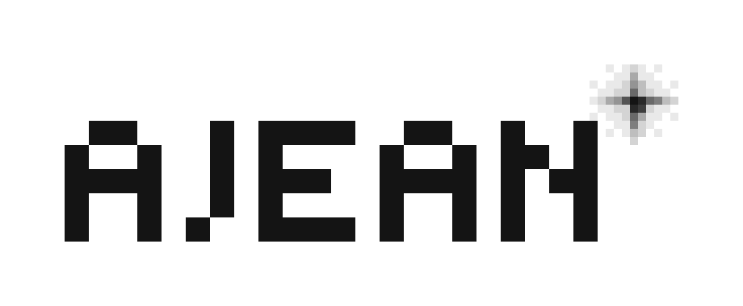
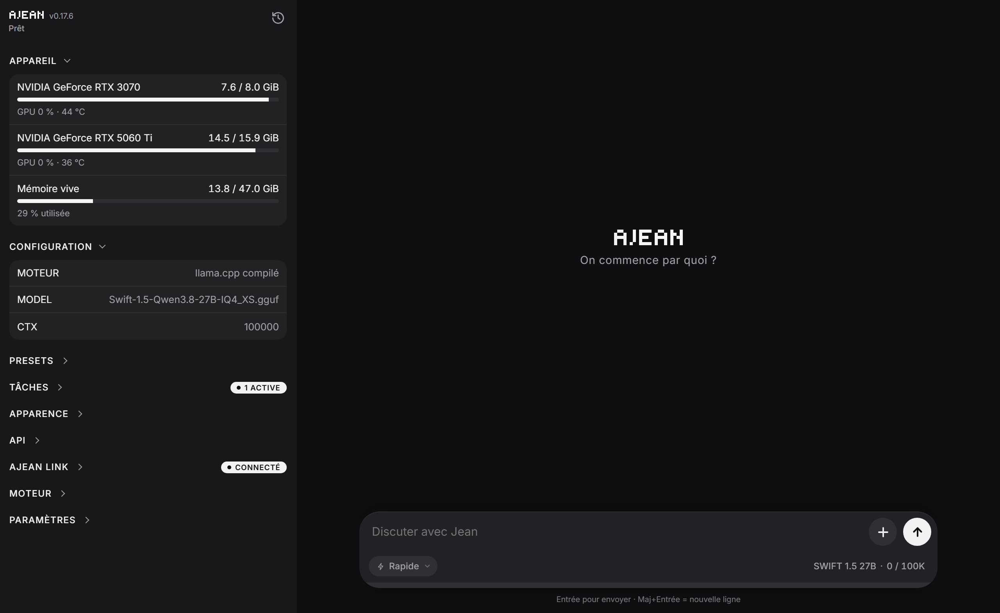

<p align="center">
  <picture>
    <source media="(prefers-color-scheme: dark)" srcset="docs/logo-dark.png">
    
  </picture>
</p>

**English** · [Français](README.fr.md)



**Run your own AI at home.** AJEAN is a single program that turns a computer with a graphics card (or a plain CPU) into a complete AI assistant: a chat interface, memory, tools, web access, scheduled tasks, and access from your phone, with nothing leaving your machine.

AJEAN handles everything around the model. The model runs on the engine of your choice (llama.cpp, ExLlama, vLLM, etc.) or on a remote OpenAI-compatible API. AJEAN starts it, stops it and watches over it.

- **One file, no dependencies.** No Docker, no Python, no runtime to install. Linux, Windows and macOS.
- **An assistant, not just a model.** It remembers, organizes work into projects, runs commands, reads the web, drives a browser, and works on its own on a schedule.
- **Your data stays yours.** Everything runs on your machine. Memory and conversations can be encrypted at rest, and remote access is encrypted end to end.
- **Use it from anywhere.** The same conversations on your computer and your phone, live.
- **Plugs into your tools.** An OpenAI-compatible endpoint for any third-party app.

---

## Contents

- [Install](#install)
- [Using AJEAN](#using-ajean)
- [What the AI can do](#what-the-ai-can-do)
- [Models](#models)
- [Access from anywhere](#access-from-anywhere)
- [Your data](#your-data)
- [Reference](#reference)
- [Build from source](#build-from-source)

---

## Install

Download the file for your system from the [latest release](https://github.com/nathaninline/ajean/releases/latest):

| System | File |
|---|---|
| Windows | `ajean-windows.exe` (`ajean-windows-arm.exe` for ARM) |
| macOS | `ajean-macos-arm.zip` (Apple Silicon), `ajean-macos.zip` (Intel) |
| Linux | `ajean-linux` (`ajean-linux-arm` for ARM) |

### Windows

Double-click `ajean-windows.exe`. AJEAN installs itself, adds its shortcuts, and opens in its own window, with an icon in the notification area (*Open AJEAN* / *Quit*). Running a newer file later updates the installed copy.

Then add a model in the **Presets** section of the menu (see [Models](#models)). The engine is installed separately: see [docs/moteurs.md](docs/moteurs.md) (in French). Creating the Windows service asks for administrator rights once.

### macOS

Unzip, drag **AJEAN.app** into *Applications*, then **right-click and Open** the first time (the app is only ad-hoc signed). AJEAN opens in its own window and lives in the menu bar. Then add a model as on Windows.

For command-line use, take the bare binary `ajean-macos-arm` / `ajean-macos` instead of the app.

### Linux (server)

```bash
curl -L -o ajean https://github.com/nathaninline/ajean/releases/latest/download/ajean-linux
chmod +x ajean && sudo mv ajean /usr/local/bin/ajean

sudo ajean install              # interface, service helper, RAM guardian, folders
sudo ajean ui start             # interface at http://<host>:8090
```

Then add a model from the interface (**Presets** section, + button) or from the command line:

```bash
ajean service add model.json    # declare a model (see docs/moteurs.md)
ajean service use <id>          # start it and connect the chat to it
```

`ajean install` installs three things: the `ajean-ui` service (interface, remote access, OpenAI endpoint), a root helper (`/usr/local/sbin/ajean-svc`, with a sudoers rule) that only acts on the services AJEAN manages, and the `ajean-guard` RAM guardian. Models are systemd system units: they run without an open session, and restarting the interface never reloads the model.

### Updating

```bash
ajean update
```

Or the update button in the interface. Each release is verified against its published checksums before it is installed.

---

## Using AJEAN

### Four chat modes

Pick a mode from the button on the left of the input bar.

| Mode | For | What the AI has |
|---|---|---|
| **Quick** | quick questions, small tasks | terminal and files, no memory |
| **Project** | real work that spans several conversations | memory, trackers, web, browser, MCP, tasks |
| **Jean** | a personal assistant that knows you | its own memory, reminders, a single ongoing conversation |
| **Base model** | talking to the raw model | nothing: no tools, no system prompt |

A conversation keeps the mode it started in. Tools only exist when **agent mode** is on (`ajean agent on`, or the switch in the interface); without it, every mode behaves like Base model.

### Projects

A project is a workspace with **its own memory and its own conversations**, isolated from the others: one for your mailbox automation, one for a piece of software, one for your notes. Switch project from the bubble in the input bar.

Each project has:

- **A memory**: Markdown pages the AI reads and writes across conversations, with an index kept up to date automatically.
- **Trackers**: dated data that keeps growing (a weekly subscriber count, a weight, a revenue figure). The AI browses them level by level instead of loading everything.
- **A description**, given to the AI at the start of every conversation (context, constraints, tone).
- **Options** in its *⋯* menu: name and description, its memory, its trackers.

### Jean, personal assistant

Jean is an assistant that remembers **you** over time, in a single conversation that never ends. Open it from the mode menu: it gets a full-screen view with its avatar.

- **Its own memory**: a short profile (name, family, preferences, habits), *fiches* (procedures, recipes, guides kept in full), and a journal where every exchange is logged and searchable. The *Jean memory* window lets you review, edit or delete all of it.
- **Reminders and tasks**: ask Jean to remind you of something, and the reminder arrives as a message from Jean, with a notification.
- **A separate workspace**: Jean cannot modify your projects' scripts, files or memory. It can read them, to see how something was done, and rebuild what it needs in its own space.
- **A fresh start after a break**: after 3 hours without a message, the model's context starts over. The thread on screen and the journal stay.

### History

The clock icon at the top of the side menu switches to the history. It follows what you are doing: the active project's conversations in Project mode, the quick conversations in Quick mode, the Base model conversations in Base model mode. Search covers every conversation. Conversations can be renamed, pinned as favorites, moved to another project, and exported to Markdown or JSON.

Conversations live on the server, so they are the **same on every device**, live: start a question on your computer, read the answer on your phone. Closing the browser never stops a reply.

### In the terminal

```bash
ajean chat
```

A lightweight chat in the terminal, independent from the web interface, with three tools (`bash`, `write`, `edit`) that work **in the folder where you run it**. Handy for working on a project directory.

---

## What the AI can do

These tools are given to the model only when agent mode is on.

**Terminal and files.** The AI runs commands (bash, or `cmd.exe` on Windows) and writes or edits files. It works in a disposable **workspace**; scripts worth keeping go into a separate **scripts** folder that a cleanup never touches.

**Memory.** Per project, four settings: *injected* (the index is loaded up front), *search* (the AI looks things up when needed, lighter on context), *on demand* (only when you ask), or *off*.

**Web.** `web_search`, `web_open`, `web_read` and `web_grep`, with the built-in engine: nothing to install. It reads pages served as HTML, without running their JavaScript.

```bash
ajean internet on
```

**Browser control.** With `ajean computer on`, the AI drives a real Chrome, Chromium or Edge on the machine: open a page, click, type, scroll. It targets elements through the accessibility tree, so it works even with small text-only models. You see a live preview while it browses.

**Images.** Attach an image to a message, and a multimodal model sees it and can use it. Images are resized before being sent.

**Files.** Send files to the AI from the chat (up to 1 GB each), and download the files it creates with a click.

**MCP servers.** Plug in any [Model Context Protocol](https://modelcontextprotocol.io) server (files, databases, mail, APIs) from the interface, over stdio or HTTP. The format is the one used by Claude Desktop, so an existing configuration copies over as is. Servers and individual tools can be switched on and off.

**Scheduled tasks.** The AI works on its own, at the frequency you choose (every N minutes, hours or days, or a cron expression): check a mailbox, summarize news, follow a figure. A task can also be a **script only**, run without loading the model. Each task chooses its project, its model, and whether it may use memory and the web. A master switch pauses everything.

**Notifications.** Get notified when a reply is ready, even with the app closed or the phone locked. On iPhone, add AJEAN to the home screen first.

**Long conversations.** When the context fills up, older turns are summarized automatically. Long tool results are archived and can be recalled by the AI when needed, so nothing is truly lost.

---

## Models

AJEAN manages no engine. It installs and builds nothing and downloads no model. A **model** is a **system service** that AJEAN starts, stops and watches over:

| Runs on | How it works |
|---|---|
| **This machine** | a command, written as in a terminal, that serves an OpenAI-compatible API |
| **Remote API** | any OpenAI-compatible endpoint |

Depending on the system, the service is a systemd system unit (Linux, written by the root helper), a Windows service (administrator rights once) or a launchd agent (macOS, untested). AJEAN only drives the services it writes itself.

**The safeguard.** Before starting, AJEAN checks that the program exists, that the port is free and that RAM and VRAM are sufficient. It then waits for the API to answer, within an adjustable delay, and a model that keeps crashing is stopped. While running, if free RAM gets too low, the model is stopped before the machine freezes. On Linux this is the job of the `ajean-guard` guardian: it runs as root, apart from the interface, and stops the hungriest model.

**In the interface.** The **Presets** list in the menu shows the models. A click connects the chat to a model, started if needed. The gear opens its window: command, API address (derived from the command), context, vision, system prompt, sampling, reasoning effort, safeguard, log and benchmark. The **Device** section shows the state of the machine (graphics cards and memory).

The [docs/moteurs.md](docs/moteurs.md) guide (in French) explains how to plug in an engine. Presets from 0.18 (llama.cpp and ExLlama) are converted automatically on first start. The built-in MoE engine must be recreated by hand.

---

## Access from anywhere

### ajean.link

`ajean link <token>` (or the *Remote access* panel) connects your server to the [ajean.link](https://ajean.link) relay through an **outbound** connection: no port to open, works behind any router or CGNAT. You then use AJEAN from [app.ajean.link](https://app.ajean.link), on any device.

It is an optional paid service (4.80 EUR/month). Everything else in AJEAN is and will stay open source and free.

**The relay is blind.** It carries your data without being able to read it:

- everything (chat and settings) is encrypted end to end between your browser and your server (X25519, AES-GCM);
- the key is derived from your password (OPAQUE) and never leaves the browser;
- each browser is paired once with a single-use code (`ajean link code`), and requests cannot be forged or replayed;
- the web app is served from an independent origin (GitHub Pages), so the relay cannot inject code.

The relay only sees technical metadata (machine online, loaded model, VRAM), never your conversations.

**Backups (subscribers).** Memory, models (their definitions) and settings can be backed up to ajean.link, by hand or daily. They are encrypted on your server first: the relay only stores an unreadable blob.

### OpenAI-compatible endpoint

Any tool that speaks the OpenAI API can use your model. The **API** panel of the interface shows the address, the name and the key of the chat model.

- **on your network**: the model must listen on all interfaces (`--host 0.0.0.0` in its command for llama.cpp). If it only listens on `127.0.0.1`, the panel says so;
- **on the internet**: an opt-in public address `https://<machine>.oai.ajean.link/v1`, protected by the model's API key. TLS ends on your machine; the relay only passes encrypted traffic through.

---

## Your data

Everything lives under **`$AJEAN_HOME`**: `/etc/ajean` on Linux, `%ProgramData%\ajean` on Windows, `/etc/ajean` or `~/Library/Application Support/ajean` on macOS. `ajean where` shows the exact paths.

| | |
|---|---|
| `ajean.db` | settings, conversations, keys (a single [bbolt](https://github.com/etcd-io/bbolt) database) |
| `services.json` | model definitions |
| `memory/` | memory pages, one folder per project |
| `models/` | model files, if you keep them here (a model can live anywhere) |
| `workspace/` | the AI's disposable working folder |
| `scripts/` | the scripts the AI keeps |

**Encryption at rest** (optional, one switch in the settings) encrypts memory and conversations with AES-256. The key is your access key to the interface: it lives only in your browsers, the server keeps just its fingerprint. A **recovery key** is given when you turn it on. A snapshot is taken before every switch, so nothing can be lost.

---

## Reference

### Commands

```
Models
  service list | show <id>      list models / show a model definition
  service add <file.json>       add or replace a model
  service rm <id>               remove a model (it is stopped)
  service start <id> [--force]  start with the safeguard (--force: skip the RAM and VRAM check)
  service stop | restart <id>   stop / restart
  service logs <id> [n]         a model's log
  service use <id>              start if needed and connect the chat to it
  service autostart <id> on|off start with the machine
  service why <id>              reason for the last stop
  service convert [--dry-run]   create one model per old preset
  start | stop | restart [id]   control a model (no id: the chat's model)
  status | logs [id] [n]        model status / log
  test | bench [N]              check that the AI answers / measure speed
  vram                          GPU memory

Interface (ajean-ui)
  ui [start|stop|restart|status]
  web [PORT]                    serve the interface in the foreground (default :8090)
  set-web-key [key]             protect the control API

AI
  chat                          terminal chat (tools in the current folder)
  export [options] [file]       export the conversation (--json, --last N...)
  agent [on|off|status]         give the AI its tools
  computer [on|off|status]      browser control
  memory [off|ondemand|always|search|status]
  internet [on|off|status]

Remote access (ajean.link)
  link <token> | link code | link status | link logout | link newid

Installation
  install | uninstall | update [--check] | where | version
  install-helper [user]         Linux: root helper for models and RAM guardian
```

### Settings

Machine settings are set in the interface, **Settings** section: web access, browser control, MCP servers, context compaction, encryption, notifications. The memory mode is set per project; `ajean memory` sets the default one. Engine settings (model file, GPU layers, KV cache, etc.) are part of the model's command.

### Environment variables

| Variable | Role | Default |
|---|---|---|
| `AJEAN_HOME` | data folder | see [Your data](#your-data) |
| `AJEAN_CHROME` | browser used for browser control | auto-detected |
| `AJEAN_RAM_FLOOR_MB` | minimum free RAM (MB) before a model is stopped, outside the Linux guardian | 3% of RAM, at least 1024 |
| `AJEAN_GUARD_MIB` | Linux: RAM guardian threshold (MiB), set on the `ajean-guard` unit with a systemd drop-in | `2048` |

### Control API

The interface service exposes an HTTP API. Protect it with `ajean set-web-key`, then send `Authorization: Bearer <key>` with every `/api/*` call.

| Method | Endpoint | Role |
|---|---|---|
| GET | `/api/ping` | connectivity and key check |
| GET | `/api/status` · `/api/vram` | chat model state · GPUs |
| GET | `/api/services` | models and their status |
| POST | `/api/services/start` · `/api/services/stop` | start · stop a model |
| POST | `/api/services/use` | connect the chat to a model |
| GET | `/api/services/logs` | a model's log |
| POST | `/api/chat` `{"messages":[...]}` | chat (SSE stream) |

The key travels in the clear over HTTP: for public exposure, put HTTPS in front or use ajean.link.

---

## Build from source

Go 1.25 or later. AJEAN is pure Go; the interface is embedded in the binary.

```bash
git clone https://github.com/nathaninline/ajean.git
cd ajean
CGO_ENABLED=0 go build -o ajean ./cmd/ajean   # Linux, Windows
go build -o ajean ./cmd/ajean                 # macOS (the menu bar icon needs CGO)
```

**Layout**

- `cmd/ajean/`: entry point and Windows resources.
- `internal/ajean/`: all the code, files grouped by prefix (`web_*`, `chat_*`, `llm_*`, `services_*`, `backend_*`, `relay_*`, `sys_*`, `mcp_*`, `jean_*`); a map in `doc.go`.
- `internal/ajean/ui/`: the web interface. `index.html` is **generated**: edit `ui/src/`, then run `go generate ./internal/ajean`.
- `tools/`: build helpers (`assemble-ui`, `gen-icon`, `verify-i18n`).

The interface is available in English and French; see [docs/TRANSLATING.md](docs/TRANSLATING.md) to add a language.

## License

[MIT](LICENSE). The embedded `marked.min.js` is [Marked](https://github.com/markedjs/marked), also MIT.
